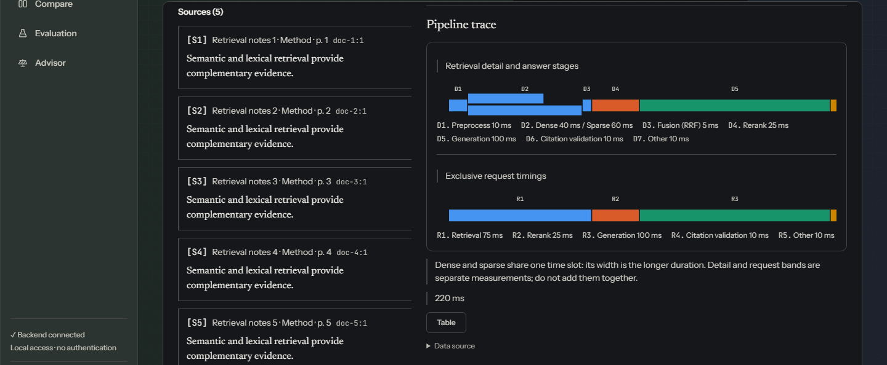

# Litmus

Litmus is a workbench for comparing retrieval-augmented generation (RAG) strategies and measuring how well each one grounds its answers.

> **Status:** active development. CI runs linting, type checks and the automated test suite. The container workflow and provider-backed runs are documented in `tools/verify-local.*` and are being validated on more setups.

Retrieval that grades itself.



Pipeline trace showing sample data from the deterministic screenshot fixtures.

Litmus provides Classic, Graph and Agentic retrieval strategies, cited answers, retrieval diagnostics and an evaluation harness. Strategy availability depends on configured providers and credentials. The evidence score is a heuristic, not a calibrated probability of correctness.

## Quick start

On Windows 11, use WSL2 and Docker Desktop with WSL integration. In PowerShell, check:

```powershell
wsl --status
docker version
```

Place your checkout in the WSL Linux filesystem, such as `~/litmus`, rather than a Windows-mounted directory. Run the following commands from that checkout in WSL.

```sh
cp .env.example .env
```

Use `.env.example` as a template only. Fill required values locally, including the database password; keep `.env` and credentials out of version control and logs.

For an OpenAI-compatible generator, set `GENERATOR_PROVIDER=openai`, `OPENAI_BASE_URL`, `OPENAI_API_KEY` and `OPENAI_GENERATOR_MODEL` in your local configuration. Choose a model supported by that endpoint. Endpoint compatibility and model support must be checked with your provider. Features requiring Anthropic credentials may be disabled; an OpenAI-compatible generator alone does not imply graph, agentic or judge support. Check `/health` for feature availability.

```sh
python3.11 -m venv .venv
. .venv/bin/activate
python -m pip install -e './backend[dev,openai]'
python tools/download_models.py --cache-dir .hf_cache
docker compose --env-file .env -f infra/docker-compose.yml build
docker compose --env-file .env -f infra/docker-compose.yml up -d
docker compose --env-file .env -f infra/docker-compose.yml exec backend python /tools/ingest.py
curl --fail http://localhost:8011/health
curl --fail http://localhost:8011/ask -H 'Content-Type: application/json' -d '{"question":"What is retrieval augmented generation?","strategy":"classic"}'
```

Open [the frontend](http://localhost:5173) and inspect returned citations and trace details. If API authentication is enabled, supply your locally issued bearer token when calling protected endpoints. First model use can require network access and disk space. See [backend setup](docs/guides/backend-setup.md) and [Windows setup](docs/guides/windows-wsl2.md) for diagnostics.

Default ingestion reads `data/docs` only. `python tools/ingest.py --with-meta` also includes this README, `docs/architecture.md` and `docs/guides/rag-walkthrough.md`. Measure that optional corpus separately.

## Evaluation

With the backend installed and services configured:

```sh
python tools/run_eval.py --dry-run --all-datasets
python tools/benchmark_retrieval.py --dataset golden_v3 --modes sparse
python tools/run_eval.py --dataset golden_v3 --no-judge
python tools/run_eval.py --dataset golden_v3 --fail-on-regression
```

Retrieval metrics measure document relevance against dataset labels. Refusal scoring and failure counts are separate from answer-quality aggregates. A citation or high evidence score does not guarantee factual correctness. This README includes no measured performance results. See [evaluation methodology](docs/evaluation-methodology.md) and [benchmark instructions](data/benchmarks/README.md).

## Documentation

- [Architecture](docs/architecture.md)
- [How the retrieval strategies work](docs/guides/rag-walkthrough.md)
- [Monitoring and data residency](docs/guides/monitoring.md)
- [Security policy](SECURITY.md)
- [Privacy guide](docs/gdpr/README.md)
- [Third-party notices](THIRD_PARTY_NOTICES.md)

## Verification

The backend supports Python 3.11. The frontend requires Node `^22.12.0 || >=24.0.0`. Install frontend dependencies with `npm ci` in `frontend/`. The [CI workflow](.github/workflows/ci.yml) defines lint, type, test, coverage, packaging and build checks. Tests use isolated fixtures; they do not establish live-provider accuracy.

[MIT License](LICENSE).
